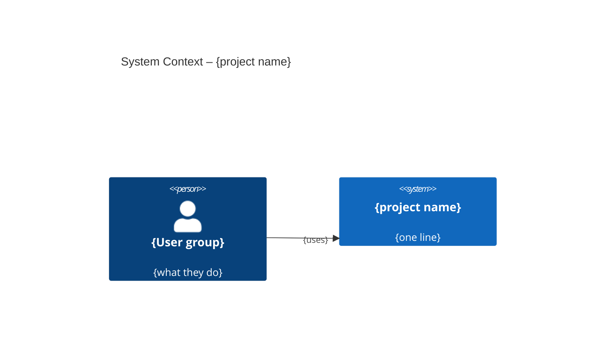
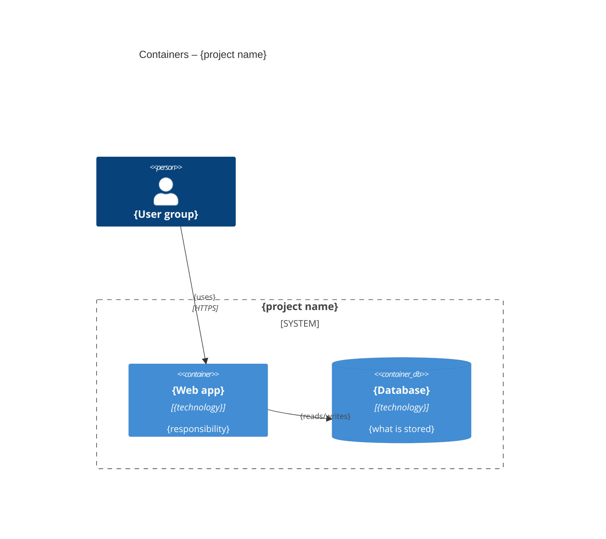

# Architecture – {project name}

<!-- arc42 lite (arc42 template v8 section order). Mandatory sections: 1, 2, 3, 4, 5, 7, 8, 9, 11.
     Optional sections (6, 10, 12): keep the heading and write "Not applicable." if empty.
     Diagrams: C4 model (System Context and Container; Component only if needed) as Mermaid C4 diagrams.
     Written for a non-technical reader first: say WHAT and WHY in plain words, details after. No code. -->

| Field | Value |
|---|---|
| Baseline version | {set by the factory (GA4.3)} |
| Based on PRD version | {PRD version} |
| Stack profile | {profile id and version (GA4.1)} |

## 1 Introduction and goals
{What the system does in two sentences (link PRD 1, 7). Top 3 quality goals from PRD 8, each with why.}

## 2 Constraints
{Technical and organisational constraints from PRD 9 and the stack profile.}

## 3 Context and scope
{Users and external systems the product talks to.}



## 4 Solution strategy
{Stack (language, framework, database, login, tests, hosting) from the stack profile, and the key decisions with links to their ADRs.}

## 5 Building block view
<!-- Example only: replace with the containers this project really needs. Do not add a web app, database or other component just because it appears here. -->

{One line per container: responsibility and why it exists.}

## 6 Runtime view (optional)
{Only important or non-obvious flows, e.g. login.}

## 7 Deployment view
{Where it runs (environments, hosting region), how it is started (Dev Container, images).}

## 8 Crosscutting concepts
### 8.1 Data model
<!-- ER diagram only when a data model applies; otherwise write "Not applicable." and delete the example. -->
{What is stored, where, relations, retention and deletion. Plain language; an ER diagram where useful. Or "Not applicable."}

```mermaid
erDiagram
  {ENTITY} ||--o{ {OTHER} : {relation}
```

### 8.2 Security and privacy
{Authentication, authorisation, personal data, secrets handling (link PRD 8).}

### 8.3 Other concepts
{Only what applies: internationalisation, error handling, logging, accessibility, UI design system (link DESIGN-SYSTEM.md).}

## 9 Architecture decisions
| ADR | Title | Relevance | Status |
|---|---|---|---|
| [0001](adr/0001-{slug}.md) | {title} | {product-relevant \| internal} | {proposed \| accepted \| …} |

## 10 Quality requirements (optional)
{Refinement of PRD 8 into checkable scenarios, if the PRD is not specific enough.}

## 11 Risks and technical debt
| Risk | Impact | Mitigation |
|---|---|---|
| {risk} | {impact} | {mitigation} |

## 12 Glossary (optional)
| Term | Meaning |
|---|---|
| {term} | {meaning} |
